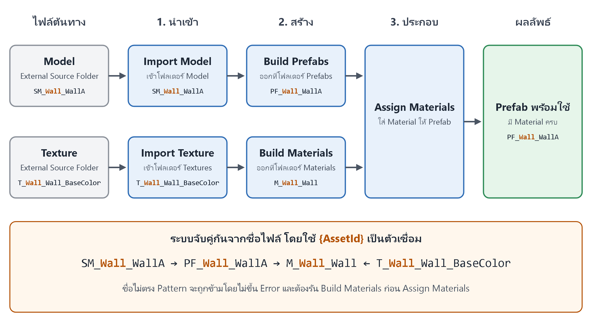
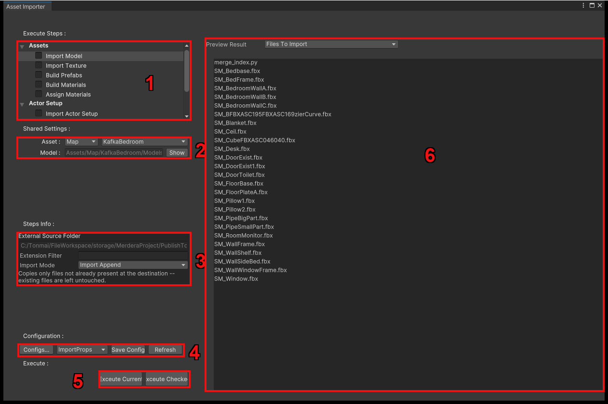

# Asset Import

ใช้นำ Model และ Texture ของฉากกับพร็อปเข้า Unity แล้วต่อเป็น Prefab ที่มี Material พร้อมใช้
ไม่ต้องทำมือทีละชิ้น เปิดได้ที่ `UkoreHub > Asset Importer...`

ไฟล์ต้นทางอยู่ที่ `PublishToUnity/model/` และ `PublishToUnity/map/`

1. **Execute Steps** — เลือก Step ที่จะดู และติ๊ก Step ที่จะรันรวมกัน หน้านี้ใช้แค่หมวด **Assets**
2. **Shared Settings** — โฟลเดอร์ปลายทางของ Step นี้ใน Unity
3. **Steps Info** — ค่าของ Step นี้ เช่น External Source Folder, Extension Filter, Import Mode
4. **Configuration** — บันทึกหรือเรียกชุดค่าที่ตั้งไว้
5. **Execute** — **Execute Current** รัน Step ที่เลือกอยู่ ส่วน **Execute Checked** รันทุก Step ที่ติ๊กตามลำดับ
6. **Preview Result** — ดูก่อนรันว่าเจอไฟล์อะไร และชื่อไหนผ่านหรือไม่ผ่าน

## กฎที่ต้องรู้: ตั้งชื่อให้ตรง Pattern

ระบบจับคู่ไฟล์จากชื่อเท่านั้น โดยใช้ `{AssetId}` เป็นตัวเชื่อม

| ประเภท | Pattern | ตัวอย่าง |
| --- | --- | --- |
| Model | `SM_{AssetId}_{PartName}` | `SM_Wall_WallA` |
| Prefab | `PF_{AssetId}_{PartName}` | `PF_Wall_WallA` |
| Material | `M_{AssetId}_{SlotName}` | `M_Wall_Wall` |
| Texture | `T_{AssetId}_{SlotName}_{MapName}` | `T_Wall_Wall_BaseColor` |

`{PartName}` และ `{SlotName}` จะมีหรือไม่มีก็ได้ แก้ Pattern ได้ที่ `UkoreHub > Template Editor... > Naming Convention`

!!! note "ชื่อไม่ตรงจะไม่ขึ้น Error"
    ไฟล์นั้นจะถูกข้ามไปเฉยๆ ก่อนรันให้ดูรายการ Invalid ใน **Preview Result** ทุกครั้ง

ไฟล์ที่ใช้ `{AssetId}` เดียวกันจะได้ Material ตัวเดียวกัน เหมาะกับชิ้นส่วนที่ใช้ร่วมกัน
แต่ถ้าตั้งชื่อซ้ำโดยไม่ตั้งใจ ก็จะถูกรวมเป็น Material เดียวด้วย

## วิธีใช้

1. ตั้งชื่อไฟล์ให้ตรง Pattern
2. เลือก **Import Model** ใส่ External Source Folder แล้วตั้ง Extension Filter เช่น `.fbx`
3. เลือก **Import Texture** แล้วตั้งค่าแบบเดียวกัน เช่น `.png`
4. เลือก **Build Prefabs** แล้วเช็ก Preview Result
5. เลือก **Build Materials** เลือก **Mapping Template** แล้วเช็ก Preview Result
6. เลือก **Assign Materials** แล้วเช็ก Preview Result
7. ติ๊กทุก Step ที่จะใช้ แล้วกด **Execute Checked**

ต้องรัน Build Materials ก่อน Assign Materials เสมอ เพราะ Assign Materials ไม่สร้าง Material ให้

## แต่ละ Step ทำอะไรให้

- **Import Model / Import Texture** — Copy ไฟล์เข้าโปรเจกต์พร้อมโครงสร้างโฟลเดอร์ย่อย
- **Build Prefabs** — สร้าง Prefab จาก Model เช่น `SM_Wall_WallA` ได้ `PF_Wall_WallA`
- **Build Materials** — รวม Texture ที่มี `{AssetId}` เดียวกันเป็น Material แล้วเสียบ Map ตาม Mapping Template
- **Assign Materials** — ใส่ Material ให้ทุก Slot ของ Prefab **โดยทับของเดิม**

## ตัวเลือกตอนรันซ้ำ

| Import Mode | ผล |
| --- | --- |
| Clean and Import | ย้ายไฟล์เดิมที่ตรง Filter ลง Recycle Bin แล้ว Copy ใหม่ (ถามยืนยันก่อน) |
| Import Append | Copy เฉพาะไฟล์ที่ยังไม่มี |
| Import Append and Replace | Copy ทับทั้งหมด แต่ไม่ลบอะไร |

| Build Behaviour | ผล |
| --- | --- |
| Add Only (ค่าเริ่มต้น) | ไม่แตะ Prefab ที่มีอยู่แล้ว |
| Add and Overwrite | เขียนทับ Prefab เดิม |
| Clear and Add | ลบ Prefab ทั้งหมดในโฟลเดอร์ก่อน **ย้อนกลับไม่ได้** |

!!! note "ตัวละครและช็อตไม่ได้ใช้หน้านี้"
    ตัวละครใช้ Import Actor Setup ส่วนช็อตใช้ [Shot Importer](../unity_ukore_shotimporter/quick-start.md)
    ดูรายละเอียดทุก Step ได้ที่ [Unity Ukore Importer](../unity_ukore_importer/quick-start.md)

## เจอปัญหา?

| อาการ | ลองดู |
| --- | --- |
| ไฟล์หายจากผลลัพธ์ | ชื่อไม่ตรง Pattern ดูรายการ Invalid ใน Preview Result |
| Prefab ไม่ได้ Material | ยังไม่ได้รัน Build Materials หรือ `{AssetId}` ไม่ตรงกัน |
| Material ขาด Map บางตัว | `{MapName}` ไม่ตรงกับ Slot ใน Mapping Template |
| Material ที่ใส่เองหาย | รัน Assign Materials ซ้ำ ระบบทับของเดิม |
