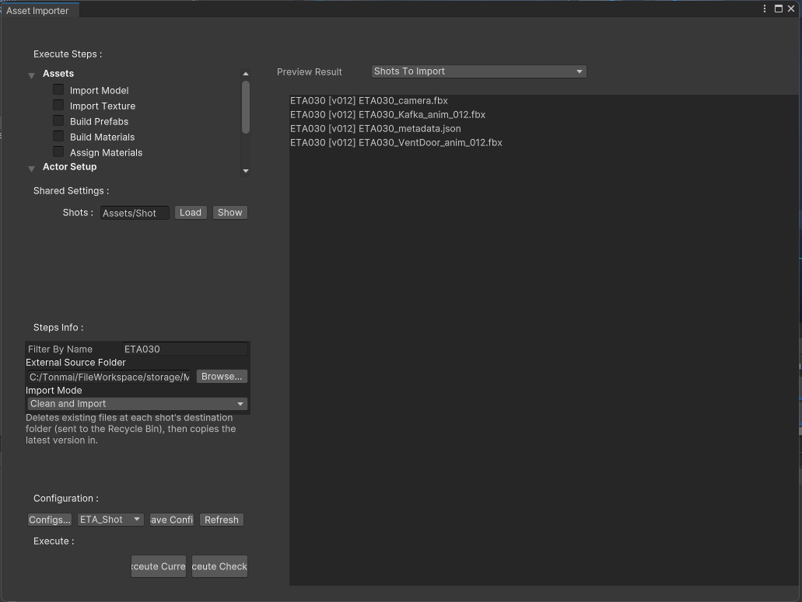
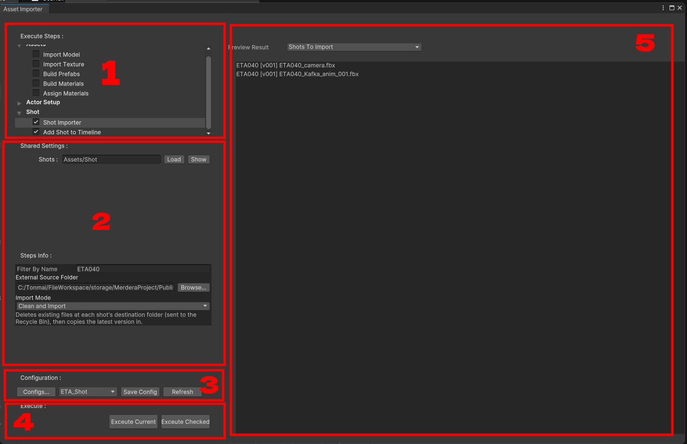

#Ukore Asset Importer 

เป็น Tools ที่สร้างออกแบบมาเพื่อรวมรวม Operation ทุกอย่างในการ Import , Build , Set-up Assets , Shot ต่างๆ ครบจบในที่เดียว โดยส่วนใหญ่จะ Detect การตรวจหาความหมายต่างๆ ผ่าน Naming Convention ของไฟล์ และ Sub Directories ของโฟลเดอร์ที่ Import ว่าสอดคล้องกับ Hierarchy ที่ระบบต้องการหรือไม่

# องค์ประกอบต่าง

โดยจะแบ่งพาร์ทต่างๆ และความหมายของแต่ละพาร์ทได้ดังนี้

### 1. Execute Steps
เป็น Step ที่เราต้องการจะรัน ซึ่งจะถือแบ่งเป็นหมวดหมู่ Assets, Actor Set-up , Shot ซึ่งเราสามารถกด Check Enable เฉพาะ Step ที่เราต้องการได้

### 2. Step Settings
เอาไว้ตั้งค่า Setting ของ Step นั้นๆ เช่น Import Path , Import Behaviour 

### 3. Configuration
เอาไว้จัดการ Preset ที่เราเคยสร้างเอาไว้ เพราะแต่ละ Sequence Shot Import ก็จะเป็น Config ที่แตกต่างกันออกไป

### 4. Execute Steps
สามารถเลือกได้ว่าจะรัน Step ที่เลือกปัจุบัน หรือรันตาม Order ทั้งหมดที่ติ้ก Checked เอาไว้

### 5. Preview Result
เอาไว้ Preview ผลลัพธ์ของแต่ละ Steps ว่า Detect Naming Convention อะไรเจอบ้าง อะไร Valid, Invalid สำหรับ Steps นั้นก็จะแสดงตรงนี้

# รายละเอียดการทำงานแต่ละ Step

ทั้ง 8 Step ถูกแบ่งเป็น 3 หมวดหมู่ตาม Execute Steps คือ **Assets** (Model → Prefab
→ Material), **Actor Set-up** และ **Shot** โดยแต่ละ Step จะอ่าน/เขียนผ่าน Shared
Folder ที่ตั้งไว้ด้านบน (Model, Textures, Prefabs, Materials, Shots, Timeline,
Scene) ยกเว้น Import Actor Setup ที่ใช้ Import Path ของตัวเอง ไม่ยุ่งกับ Shared
Folder เลย

## หมวด Assets

### Import Model / Import Texture
**Require:** External Source Folder ที่เข้าถึงได้ (path นอกโปรเจกต์ก็ได้ ไม่ต้อง
อยู่ใต้ Assets/) เท่านั้น ไม่ต้องมี Step อื่นรันมาก่อน

**ระบบตรวจจับ:** สแกนไฟล์ทุกไฟล์ใน External Source Folder แบบ Recursive แล้ว
กรองด้วย Extension Filter (คั่นด้วย `,` หรือ `;` มี `.` นำหน้าหรือไม่ก็ได้ เว้นว่าง
= เอาทุกไฟล์) ยังไม่มีการตรวจ Naming Convention ในขั้นนี้ — โครงสร้าง Subfolder
ของต้นทางจะถูกคัดลอกตามไปด้วย

**Import Mode:** Clean and Import (ส่งไฟล์เดิมในปลายทางที่ตรง Filter เข้า Recycle
Bin ก่อน แล้ว Copy ใหม่ทั้งหมด มี Popup ยืนยันจำนวนไฟล์ก่อนรันเสมอ), Import Append
(Copy เฉพาะไฟล์ที่ยังไม่มีที่ปลายทาง), Import Append and Replace (Copy ทับทุกไฟล์
ไม่ลบอะไร)

### Build Prefabs
**Require:** ต้องมี Model อยู่ใน Shared Model Folder แล้ว (จะ Import Model มาก่อน
หรือใส่เองก็ได้)

**ระบบตรวจจับ:** ไล่หา GameObject ที่เป็น Model จริง (`PrefabAssetType.Model`)
ใต้ Model Folder แบบ Recursive เท่านั้น (Prefab ที่มีอยู่แล้วจะไม่ถูกนับ) แล้ว
Parse ชื่อไฟล์ด้วย Regex ที่ Generate มาจาก Naming Convention ของ Model (เช่น
`{AssetType}_{AssetId}_{PartName}`) เพื่อดึง Token ต่างๆ ออกมา จากนั้นเอา Token
เหล่านั้นไป Format ชื่อ Prefab ใหม่ตาม Naming Convention ของ Prefab (สลับแค่
`{AssetType}` Token เป็นของ Prefab เช่น `SM_Wall_WallA` → `PF_Wall_WallA`) ถ้า
ชื่อไม่ตรง Pattern หรือ Pattern ไม่มี `{AssetId}` จะถูกจัดเป็น Invalid และข้ามไป
โดยไม่ error

**Build Behaviour:** Add and Overwrite, Add Only (Default — ไม่แตะ Prefab ที่มี
อยู่แล้ว เผื่อมีคนสร้างมือ), Clear and Add (ลบ Prefab เดิมทั้งหมดในปลายทางก่อน
แล้วสร้างใหม่ ต้อง Confirm เพราะ Undo คืนไม่ได้)

### Build Materials
**Require:** ต้องมี Texture อยู่ใน Shared Textures Folder แล้ว และต้องเลือก
Mapping Template (`MaterialTemplate` Asset ที่สร้าง/แก้จาก Template Editor) ไว้
ด้วย — Step นี้ไม่อ่าน Prefab หรือ Model เลย

**ระบบตรวจจับ:** Parse ชื่อไฟล์ Texture ทุกไฟล์ด้วย Naming Convention ของ Texture
(`{AssetType}_{AssetId}_{SlotName}_{MapName}`) ได้ `{AssetId}` กับ `{MapName}`
ออกมา แล้วเทียบ `{MapName}` กับรายชื่อ Slot ที่ตั้งไว้ใน Template (ไม่สนตัวพิมพ์
เล็กใหญ่) ว่าตรงกันไหม จากนั้น Group Texture ทุกไฟล์ที่มี `{AssetId}` เดียวกันเข้า
เป็น Material เดียว (ไม่ต้องมี Token Unique/Shared แยก เพราะ Group ด้วย
`{AssetId}` อย่างเดียวก็พอ) แล้วสร้าง/อัปเดต Material จาก Shader ที่ Template
กำหนด พร้อมเสียบ Texture ตาม Slot ที่ Match ได้

ถ้า Slot ไหนมีชื่อ Property หรือ Map Name ที่มีคำว่า "emiss" อยู่ (ใช้ได้กับ
Shader ไหนก็ได้ ไม่ Hardcode เฉพาะ Ukore/Toon) และมีการเสียบ Texture จริง ระบบจะ
เปิด Emission ให้อัตโนมัติ — ตั้งสี HDR Color Property ที่มีคำว่า emiss เป็นสีขาว,
Enable Keyword `_EMISSION` และตั้ง Global Illumination Flag เป็น Realtime
Emissive ให้เอง

### Assign Materials
**Require:** ต้องมี Prefab อยู่ใน Shared Prefabs Folder แล้ว และ Material ที่จะ
Resolve เจอต้องถูกสร้างไว้ก่อนแล้ว (รัน Build Materials ก่อน)

**ระบบตรวจจับ:** ไล่โหลด Prefab ทุกตัวใต้ Shared Prefabs Folder แล้ว Parse ชื่อ
Prefab ด้วย Naming Convention ของ Prefab ได้ `{AssetId}` ออกมา แล้วประกอบเป็นชื่อ
Material ตาม Naming Convention ของ Material (ใช้ `{AssetId}` เดียวกันแทนทั้ง
`{AssetId}` และ `{SlotName}`) จากนั้นค้นหาไฟล์ Material นั้นใน Material Search
Folder — เจอ = Valid, ไม่เจอ = Skip (ไม่สร้าง Material ให้เอง)

**Apply:** ใส่ Material ที่ Resolve ได้ลงทุก Renderer Slot บน Prefab นั้น
โดยทับของเดิมทั้งหมด (Idempotent — รันซ้ำกับ Prefab เดิมได้ไม่มีปัญหา)

## หมวด Actor Set-up

### Import Actor Setup
**Require:** External Source Folder ที่มีโครงสร้าง `{ActorName}/v001/...`,
`v002/...`, ... (โครงสร้างเดียวกับ Shot Importer) — Step นี้ไม่ยุ่งกับ Shared
Model/Prefabs Folder เลย ใช้ Import Path ของตัวเอง

**ระบบตรวจจับเวอร์ชัน:** สแกนหา Subfolder ที่ชื่อขึ้นต้นด้วย `v` ตามด้วยตัวเลข
(Regex `^v(\d+)$`) แล้วเลือกเลขเวอร์ชันสูงสุด, ถ้าไม่มี Subfolder แบบ `vNNN` เลย
จะ Fallback ไปเอาไฟล์ในโฟลเดอร์ Actor ตรงๆ แทน (ใช้ Logic ตัวเดียวกับ Shot
Importer) ไฟล์ทุกไฟล์ในเวอร์ชันล่าสุดจะถูก Copy เข้ามาทั้งหมด ไม่มี Extension
Filter

**ระบบตรวจจับชื่อ:** ต่างจาก Build Prefabs ตรงที่ **ไม่ตรวจ Naming Convention
ของ Model เลย** เพราะ FBX Skeleton จาก Pipeline Animation มักตั้งชื่อตรงๆ ตาม
ตัวละคร (เช่น `Kafka.fbx`) ไม่ใช่ตาม Pattern `{AssetType}_{AssetId}_{PartName}`
— Model ทุกตัวที่เจอถือว่า Valid หมด แต่ชื่อ Prefab ยังคง Format ผ่าน Naming
Convention ของ Prefab อยู่ โดยเอาชื่อ Model ดิบมาเป็น `{AssetId}` ตรงๆ (เช่น
`Kafka` → `PF_Kafka` ด้วย Token เริ่มต้น `PF`)

**หลัง Import:** บังคับตั้งค่า ModelImporter เป็น Animation Type = Generic,
Avatar Definition = Create From This Model (Skip ถ้าตั้งไว้แบบนี้อยู่แล้ว ไม่
Reimport ซ้ำโดยไม่จำเป็น) แล้วสร้าง/Reuse Prefab ไว้ในโฟลเดอร์เดียวกับ Model เอง
(`{Import Path}/{ActorName}/{PrefabName}.prefab` ไม่ใช่ Shared Prefabs Folder)
และตั้งค่าที่ช็อตต้องใช้ให้เลย: Animator เป็น Always Animate (ไม่งั้นตัวละครจะหายจาก
วิดีโอตอนอยู่นอกกล้อง) และ Mesh ที่ยังอยู่ Default Layer ย้ายไป Light Layer 1 (ไม่งั้น
ไฟ Toon ไม่โดน ตัวจะดำ) ถ้าเลือก Add Only ค่า Layer ที่ตั้งเองไว้จะอยู่เหมือนเดิม ส่วน
Add and Overwrite สร้าง Prefab ใหม่ ค่าที่ตั้งเองจะหาย ต้องตั้งใหม่
ตาม Build Behaviour แบบเดียวกับ Build Prefabs สุดท้ายเพิ่ม/เช็ค Animator
Component บน Prefab แล้วผูก Avatar ที่ Generate จาก Model เข้าไปให้อัตโนมัติ —
รันซ้ำกับ Actor ที่ Setup แล้วก็แค่ยืนยัน Wiring เดิม ไม่พังอะไร

**Import Mode:** Clean and Import / Import Append / Import Append and Replace
เหมือน Shot Importer

## หมวด Shot

### Shot Importer
ย้ายไปเป็นหน้าต่างแยกแล้ว ดูวิธีใช้ได้ที่ [Unity Ukore Shot Importer](../unity_ukore_shotimporter/quick-start.md)
(รวมถึงเรื่อง Folder ของตัวละคร/Prop ที่ต้องวางให้ถูกที่ ซึ่ง Add Shot to Timeline
ด้านล่างใช้ด้วย)

### Add Shot to Timeline (รวม Include Camera)
**Require:** มี Shot ถูก Import เข้ามาใน Shared Shots Folder แล้ว (จาก Shot
Importer) และตั้ง Scene Field ไว้ที่ Scene ปลายทางที่ถูกต้อง (ถ้ายังไม่เปิดอยู่
ระบบจะเปิดให้เองตอน Execute)

**ระบบตรวจจับ Shot ที่ Import แล้ว:** สแกน GameObject ที่เป็น Model จริงใต้ Shots
Folder, Parse ชื่อไฟล์แบบเดียวกับ Shot Importer (`ShotName_AssetName`) แล้วดึง
AnimationClip Sub-asset หลัก (ไม่นับตัวที่ขึ้นต้น `__preview__`) พร้อม Resolve
Avatar จาก `{AssetName}` ด้วยวิธีเดียวกับ Shot Importer

**ระบบตรวจจับเป้าหมายในฉาก (ตัวละคร):** มองหา Animator ทุกตัวในฉากที่เปิดอยู่
แล้วจับคู่ด้วย Avatar ที่เป็น Object เดียวกันเป๊ะ — Shot ไหนไม่มี Animator ในฉากที่
ใช้ Avatar เดียวกันจะถูกข้าม (นี่คือกลไกที่ทำให้รันทีละ Sequence ได้เอง เพราะ
Scene ของแต่ละ Sequence จะมีแค่ตัวละครของ Sequence นั้นอยู่) ถ้าเปิด **Auto Add
Missing Prefabs** ไว้ Shot ที่ยังไม่มี Animator ในฉากจะไม่ถูกข้าม แต่ระบบจะค้นหา
Prefab ตัวละครที่มี Animator ผูก Avatar ชื่อเดียวกันใน [Actor Folder](../unity_ukore_shotimporter/quick-start.md#actor-folder) (รองรับทั้ง
Regular และ Variant Prefab) แล้ว Instantiate เข้าฉากให้เองตอน Execute

**Timeline/Track:** ใช้ PlayableDirector + TimelineAsset ตัวเดียวร่วมกันต่อ
Sequence (ตาม Timeline Field ที่ระบุ หรือ Auto-resolve เป็น
`{Shots}/{Prefix}/{Prefix}_Timeline.playable` ถ้าเว้นว่างไว้) แต่ละ Shot จะถูก
เพิ่มต่อท้าย Clip ล่าสุดที่มีอยู่บน Timeline ทั้งเส้น (เรียงตามชื่อ ShotName)
ยกเว้น Clip ชื่อเดียวกันมีอยู่แล้วบน Track ไหนก็ตาม จะจัดตำแหน่งเริ่มให้ตรงกัน
(เพื่อให้ Clip ตัวละครกับ Clip กล้องของ Shot เดียวกัน Sync กันแม้รันคนละรอบ)

**Add Mode:** Add (สร้าง Clip ใหม่อย่างเดียว ไม่แตะของเดิม), Update Only (แก้ไข
Clip เดิมในตำแหน่งเดิมอย่างเดียว ไม่สร้างใหม่), Add and Update (ทำทั้งสองอย่าง
แล้วแต่กรณี)

**Filter By Name:** ค้นหาแบบ Substring ไม่สนตัวพิมพ์เล็กใหญ่กับ ShotName ใช้ทั้ง
ตอน Preview และ Execute

**Include Camera:** ปิดโดย Default — เมื่อเปิด จะดึง Shot ที่มี AssetName เป็น
`camera` มาเพิ่ม/อัปเดต Clip บน GameObject ชื่อ "RenderCam" ตัวเดียวที่ใช้ร่วมกัน
ทั้งฉาก (Reuse ถ้ามีอยู่แล้วในฉาก ไม่งั้น Instantiate จาก
`Assets/SetupActor/Camera/RenderCam.prefab` ซึ่งเป็น Fixed Path เช่นกัน) โดยปิด "Remove Start Offset" เพื่อ
ให้กล้องเล่นตาม Transform โลกจริงตามที่ Export มา ไม่ใช่ Offset ตามตำแหน่ง
ปัจจุบันของ RenderCam — Clip กล้องใช้ Filter By Name/Add Mode ชุดเดียวกับ Clip
ตัวละคร ไม่มีของตัวเอง และถูกนับรวมในผลลัพธ์ Added/Updated/Skipped เดียวกัน

## Execute Current / Execute Checked

**Execute Current** รันเฉพาะ Step ที่เลือกอยู่ตัวเดียว

**Execute Checked** รันทุก Step ที่ติ๊ก Checkbox ไว้ ตามลำดับตายตัว (Import
Model → Import Texture → Build Prefabs → Build Materials → Assign Materials →
Import Actor Setup → Add Shot to Timeline → Layout Export Scene) โดยจะโหลดข้อมูลของ
แต่ละ Step ใหม่ก่อนรันเสมอ (ไม่ใช้ Preview เก่าที่อาจ Stale) และ Refresh
AssetDatabase ระหว่าง Step ให้อัตโนมัติ ทำให้รันต่อกันเป็น Pipeline เดียวได้จริง
เช่น Import Model → Build Prefabs → Build Materials → Assign Materials หรือ
Import Actor Setup → Add Shot to Timeline โดย Step หลังจะเห็นผลลัพธ์ที่ Step ก่อนหน้า
เพิ่งสร้างเสมอ
