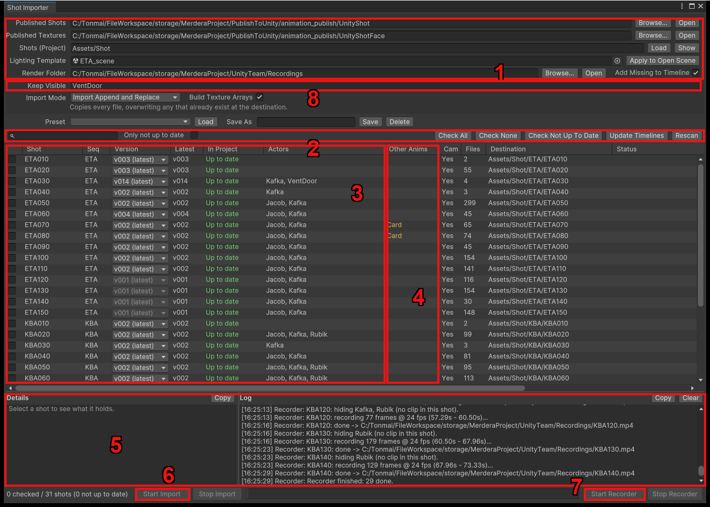

# Ukore Shot Importer

ดึง Shot ที่ Publish มาจาก Maya (Animation, กล้อง, Texture ใบหน้า) เข้า Unity
ทีละหลายๆ Shot และ Render ออกมาเป็นวิดีโอ `.mp4` ได้ในหน้าต่างเดียว

**เปิดหน้าต่าง:** `UkoreHub > Shot Importer...`

---

## ส่วนประกอบของหน้าต่าง



1. **Folder** — ต้นทาง (ที่ Maya Publish มา) และปลายทางในโปรเจกต์ ตั้งครั้งเดียวแล้วใช้ต่อได้เลย
2. **ค้นหา / เลือก** — พิมพ์ชื่อ Shot หรือชื่อ Actor เพื่อกรอง, **Check Not Up To Date** เลือกเฉพาะ Shot ที่ต้องอัปเดต, **Rescan** อ่าน Folder ใหม่
3. **รายการ Shot** — 1 แถว = 1 Shot บอกเวอร์ชัน, สถานะ และมี Actor อะไรบ้าง
4. **Other Anims (สีเหลือง)** — Animation ที่ระบบหา Actor ไม่เจอ **ต้องแก้ก่อน** ไม่งั้นจะไม่ถูกวางลง Timeline (ดู[ด้านล่าง](#actor-folder))
5. **Details / Log** — คลิก Shot เพื่อดูว่ามีไฟล์อะไรบ้าง ส่วน Log บอกผลลัพธ์และคำเตือน
6. **Start Import** — Import ทุก Shot ที่ติ๊กไว้
7. **Start Recorder** — Render ทุก Shot ที่ติ๊กไว้เป็นวิดีโอ
8. **Keep Visible** — ชื่อ Actor ที่ห้ามซ่อนตอน Render เช่นประตูในฉาก (ดู[ด้านล่าง](#auto))

---

<a id="actor-folder"></a>

## สิ่งสำคัญ: Actor ต้องอยู่ใน `Assets/SetupActor`

**Actor** คือทุกอย่างที่มี Animation ไม่ว่าจะเป็นตัวละครหรือ Prop ถือเป็นประเภทเดียวกันหมด

ระบบจะรู้ว่า Animation เป็นของใครจาก**ชื่อไฟล์** (เช่น `KBA030_Kafka_anim_001.fbx`
→ หา `Kafka.fbx`) และหา**เฉพาะใน `Assets/SetupActor` เท่านั้น** (1 Folder ต่อ 1 Actor)

```
Assets/SetupActor/          ← Actor ทุกตัวอยู่ใต้นี้
├── Kafka/Fbx/Kafka.fbx
├── Jacob/Jacob.fbx
├── VentDoor/VentDoor.fbx
└── Camera/RenderCam.prefab ← กล้องที่ใช้ Render (ไม่ใช่ Actor)
```

ถ้าตัวไหนขึ้นใน **Other Anims** แปลว่าไม่มี Model ชื่อนั้นใน `Assets/SetupActor`
ให้ย้ายไฟล์ไปไว้ให้ถูกที่ (หรือสร้างด้วย **Import Actor Setup** ใน
[Asset Importer](../unity_ukore_importer/quick-start.md)) แล้วกด **Rescan**

---

## วิธีใช้

1. กด **Rescan** ให้เห็น Shot ล่าสุด
2. กด **Check Not Up To Date** (หรือติ๊กเลือกเอง)
3. กด **Start Import**
4. ถ้าจะ Render ต่อ กด **Start Recorder**

**สถานะในคอลัมน์ In Project**

- **Up to date** (เขียว) — ล่าสุดแล้ว ไม่ต้องทำอะไร
- **Outdated** — มี Publish ใหม่ ควร Import
- **Not imported** — ยังไม่เคย Import

!!! tip "Import Mode"
    ใช้ **Import Append and Replace** (ค่าเริ่มต้น) เป็นหลัก — ทับไฟล์เดิมด้วยเวอร์ชันใหม่

---

<a id="auto"></a>

## ระบบทำอะไรให้อัตโนมัติ

- **Timeline ใช้ Animation เวอร์ชันล่าสุดเสมอ** — Import เสร็จแล้ว Clip บน
  Timeline จะเปลี่ยนเป็นเวอร์ชันใหม่ให้เอง (หรือกด **Update Timelines** ให้อัปเดตทุก Shot)
- **ผูก Animation เข้ากับ Actor** และตั้งขนาด (Scale) ตามที่ Publish มาให้เอง
- **Render:** ไม่ต้องเปิดฉากเอง ระบบหาฉากของ Shot นั้น แล้ว Render ผ่านกล้อง
  `RenderCam` ให้ ถ้าติ๊ก **Add Missing to Timeline** ไว้ Shot ที่ยังไม่อยู่บน
  Timeline จะถูกวางให้ก่อน
- **ซ่อน Actor ที่ไม่ได้อยู่ใน Shot** — ตอน Render ถ้า Actor ตัวไหนไม่มี Clip ใน Shot
  นั้น (เช่น Shot ที่ไม่มีตัวละครเลย) ระบบจะซ่อนตัวนั้นให้เอง ไม่ต้องลบออกจากฉาก
  ส่วนชิ้นที่เป็นส่วนหนึ่งของฉาก เช่นประตู ให้ใส่ชื่อไว้ในช่อง **Keep Visible**
  (คั่นด้วย `,` ค่าเริ่มต้นคือ `VentDoor`) แล้วจะไม่ถูกซ่อน

!!! note
    Texture / Material (Lookdev) ของ Actor **ไม่ได้**อัปเดตผ่านหน้านี้ ให้แก้ที่
    Material ใน `Assets/SetupActor/...` โดยตรง แล้วทุกฉากจะเปลี่ยนตามเอง

---

## เจอปัญหา?

| อาการ | วิธีแก้ |
| --- | --- |
| Actor ขึ้นใน **Other Anims** | ย้าย Model ไปไว้ใน `Assets/SetupActor` ให้ชื่อตรงกับใน Animation แล้วกด **Rescan** |
| Timeline ยังเล่น Animation เก่า | กด **Update Timelines** |
| ใน Render มีตัวละครค้างท่าจาก Shot อื่น | ตัวนั้นยังมี Clip ของ Shot นี้บน Timeline อยู่ ให้ลบ Clip นั้นออกจาก Track ของตัวนั้น (Import ใหม่ไม่ลบ Clip เก่าให้) |
| ของในฉากหายไปตอน Render | ใส่ชื่อ Actor นั้นในช่อง **Keep Visible** |
| Render ขึ้น **Failed** | เอาเมาส์ชี้ที่คอลัมน์ Render เพื่ออ่านสาเหตุ ส่วนใหญ่คือยังไม่ได้ Import หรือยังไม่ได้ติ๊ก **Add Missing to Timeline** |
